# Compras públicas federais: onde o dinheiro vai e onde há risco

Projeto de recuperação do Módulo 2 (Análise de Dados com Python e PostgreSQL).
Pipeline completo: **PNCP (arquivos brutos) → Python (limpeza) → PostgreSQL (Star Schema) → Power BI (dashboard)**.

## 1. Contexto do problema

O Portal Nacional de Contratações Públicas (PNCP) publica as compras do governo. Os arquivos brutos chegam sujos: CNPJ com máscara, dinheiro escrito de vários jeitos, datas em seis formatos e texto com acento quebrado.

A Controladoria quer respostas rápidas para 10 perguntas, por exemplo: quanto o governo economizou, quem concentra o orçamento e onde se pagou acima do estimado. Para isso eu limpei a base, montei um banco dimensional e fiz um dashboard com uma página por pergunta.

Recorte da base (arquivos em `data/raw/`): 2.042 contratações, 7.077 itens e 15.896 resultados de fornecedores.

**Sobre a primeira entrega:** eu não fiz a primeira entrega do módulo. Por isso não há devolutiva para corrigir. Todo o trabalho foi feito nesta recuperação e o histórico de commits mostra a ordem em que fui construindo.

## 2. Estrutura do repositório

```
data/raw/        arquivos brutos do PNCP (compras, itens, resultados)
data/processed/  tabelas limpas (geradas pelo Python, não vão para o Git)
src/             código Python (limpeza, montagem das tabelas, carga, conferência)
sql/             criação do banco e as 10 perguntas
powerbi/         dashboard (.pbix) e tema de cores
docs/img/        prints do dashboard e figura das Sprints
```

## 3. Tecnologias

- Python 3 com pandas (limpeza e montagem das tabelas) e psycopg2 (conexão e carga em lote)
- PostgreSQL (Star Schema)
- SQL (JOIN, funções de janela, `NULLIF`, `HAVING`)
- Power BI Desktop (modelo, DAX e navegador de páginas)
- Git e GitHub

## 4. Como reproduzir do zero

1. Instale o Python 3.10+ e o PostgreSQL. Deixe o PostgreSQL ligado.
2. Clone o repositório e instale as bibliotecas:
   ```
   git clone https://github.com/alen221188/projeto_recuperacao.git
   cd projeto_recuperacao
   pip install -r requirements.txt
   ```
3. Copie `.env.example` para `.env` e preencha a senha do seu PostgreSQL.
4. Rode os passos, nesta ordem, na pasta do projeto:
   ```
   python -m src.limpeza          # testa as funções de limpeza (tem que dar 54 de 54)
   python -m src.montar_tabelas   # limpa os CSVs e grava a fato e as 4 dimensões em data/processed/
   python -m src.carregar         # recria o banco, cria as tabelas, carrega e confere as contagens
   python -m src.conferir_sql     # roda as 10 perguntas de sql/02_perguntas.sql e mostra o resultado
   ```
5. Abra `powerbi/dashboard_pncp.pbix`. Se o Power BI pedir, atualize a conexão com o seu servidor (`localhost`, banco `pncp_controladoria`).

O `montar_tabelas` imprime, linha a linha, o valor obtido e o valor esperado da prova real. O `carregar` faz o mesmo com a contagem de cada tabela.

## 5. Decisões técnicas e por quê

| Decisão | Por quê |
|---|---|
| Ler os CSVs tudo como texto (`dtype=str`) | Se o pandas converter sozinho, o CNPJ perde o zero da esquerda. |
| Limpar com funções pequenas em `src/limpeza.py` | Cada função faz uma coisa e tem exemplos de teste (54 casos). Fica fácil de explicar e de testar. |
| Dinheiro em `DECIMAL`, nunca `FLOAT` | `FLOAT` arredonda errado e a soma dos valores não fecha. |
| Chave substituta (`sk_`) em todas as tabelas | A chave natural (CNPJ, UF) fica como `UNIQUE`. A chave numérica é mais leve para o JOIN. |
| `CHECK` no banco, além da limpeza no Python | O banco é a segunda barreira. Dado impossível é recusado mesmo que o Python deixe passar. |
| Percentual sempre como soma ÷ soma | Média de percentuais dá peso igual a itens de tamanhos muito diferentes e distorce o resultado. |
| Calendário criado em DAX, fora do banco | O calendário depende só das datas da fato e é usado pela inteligência temporal do Power BI. |
| Carga em lote com `execute_values` e `rollback` | Manda todas as linhas de uma vez (mais rápido) e desfaz tudo se algo falhar. |

## 6. Regras de negócio aplicadas (`src/montar_tabelas.py`)

1. **Grão da fato:** um item de contratação (`numero_controle_pncp` + `numero_item`).
2. **Um vencedor por item.** Primeiro tiro os resultados cancelados, depois fico com o 1º colocado (menor `ordem_classificacao_srp`, vazio vale 1). No empate, vale o menor `sequencial_resultado` lido como número.
3. **Só entram itens com resultado.** Os 852 itens sem resultado ficam de fora e não contam como rejeitados.
4. **Itens rejeitados (99).** Item com dado impossível não entra na fato. Guardo só o primeiro motivo de cada item:

   | Motivo | Itens |
   |---|---|
   | valor total estimado menor que R$ 1 | 59 |
   | valor unitário estimado ausente ou ≤ 0 | 23 |
   | homologado maior que 1.000 vezes o estimado | 7 |
   | valor unitário homologado ausente ou ≤ 0 | 6 |
   | valor total acima de R$ 1 trilhão (estoura o `DECIMAL`) | 3 |
   | quantidade vazia ou ≤ 0 | 1 |

5. **Valores:** `valor_total = valor_unitario × quantidade`, usando a quantidade homologada (se vier vazia ou zero, uso a do item), tanto no estimado quanto no homologado.
6. **Comparável:** o item não é Credenciamento (`modalidade_id = 12`) e a razão homologado ÷ estimado fica entre 0,1 e 10. A economia só existe nos itens comparáveis. Credenciamento fica sem economia, e isso é esperado.
7. **Cronologia:** homologação antes da publicação é impossível. O item continua na fato, mas sem data de homologação e sem ciclo (230 itens ficam sem ciclo).
8. **Perfil do gasto:** Bens, Serviços ou Obras e engenharia. As palavras de obra são `obra`, `construção`, `reforma` e `engenharia`, procuradas na descrição do item e no objeto da compra, como palavra inteira (`\b`). Assim "cobrança" e "dobradiça" não viram obra. Obra tem prioridade sobre as outras duas.
9. **Região:** o arquivo não traz a região, então montei a partir da UF.
10. **Fornecedor** é o CNPJ/CPF limpo. O mesmo nome com CNPJ diferente (filial) conta como fornecedor diferente.

Não discordei de nenhuma regra do enunciado.

## 7. Dicionário das inconsistências tratadas

Os números abaixo vêm do perfil dos arquivos brutos, antes da limpeza.

| Problema | Onde aparece | O que encontrei | Como tratei (função) |
|---|---|---|---|
| CNPJ/CPF com máscara e zero perdido | `cnpj_orgao`, `ni_fornecedor` | 176 CNPJ de órgão e 1.633 documentos de fornecedor com `.`, `/` ou `-`. 77 CNPJ de órgão com menos de 14 dígitos | `limpar_documento`: fica só com dígitos e devolve os zeros com `zfill`. Documento com dígitos demais vira nulo. Estrangeiro (`PE`) fica como está |
| Dinheiro em texto | `valor_unitario_estimado`, `valor_unitario_homologado`, `quantidade` | `R$` na frente (1.188 estimados e 2.650 homologados) e mistura de ponto e vírgula | `converter_numero`: ponto ou vírgula sozinho é decimal. Só o símbolo repetido é milhar. Se aparecem os dois, o último é o decimal. `(1.500,00)` vira negativo |
| Datas em vários formatos | `data_publicacao`, `data_resultado` | Seis formatos no mesmo campo: `2025-03-10`, `10/03/2025`, `10-03-2025`, `10.03.2025`, `2025/03/10` e `20250310` | `converter_data`: tenta cada formato, descarta a hora e recusa data impossível ou ano fora de 2000 a 2030 |
| Resultado antes da publicação | `data_resultado` | 230 itens da fato ficam sem ciclo por isso | A data de homologação fica vazia (`NULL`) e o item continua na fato |
| Nulos disfarçados | `porte`, `modo_disputa`, `processo`, `situacao_item`, `categoria_item`... | `N/A`, `NULL`, `-`, `0`, `SEM INFORMAÇÃO`, `NÃO SE APLICA`. Só em `porte` são 4.893 linhas | `eh_nulo` e `limpar_texto`. O `0` só é nulo em texto: em quantidade e valor ele é número |
| Porte escrito de vários jeitos | `porte` | "Não Informado", "NÃO INFORMADO", "N/A", "n/a", "Null"... | `padronizar_porte`: fica em ME, EPP, Demais ou Não informado |
| Acento quebrado | `objeto_compra`, `nome_unidade`, `descricao`, `porte`... | `Aquisição` no lugar de `Aquisição`: 173 objetos, 176 unidades e 223 descrições | `consertar_acento`: `encode("latin-1").decode("utf-8")`. Se o texto já está certo, o `try` devolve ele sem mexer |
| Espaços invisíveis e repetidos | vários textos | Caracteres de largura zero e espaços duplos | `remover_invisiveis` e `tirar_espacos` |
| Nome do órgão escrito de jeitos diferentes | `razao_social_orgao` | 440 nomes distintos no bruto e 352 depois de padronizar | `padronizar_nome`: maiúsculas e hífen com espaço dos dois lados |
| Vários classificados por item | `resultados.csv` | 466 itens com mais de um resultado (Registro de Preços) e 62 resultados cancelados | Tiro os cancelados e fico com o 1º colocado |
| Modalidade sem nome padrão | `modalidade_id` | O nome vinha de vários jeitos | O nome vem de uma tabela pelo `modalidade_id` |

## 8. Modelagem dimensional (PostgreSQL)

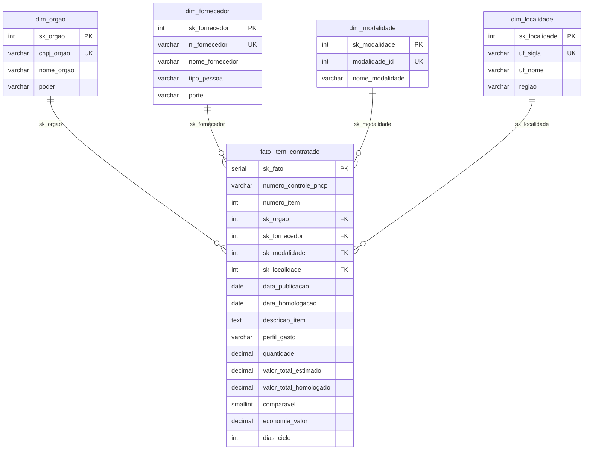

(Para caber no diagrama, deixei de fora os valores unitários. A tabela completa está em `sql/01_criar_banco.sql`.)

### Justificativa da modelagem

- **Por que Star Schema:** as 10 perguntas somam e contam valores por quem comprou, quem vendeu, como e onde. Uma fato com os números no centro e quatro dimensões em volta responde a todas com JOINs simples e deixa o Power BI mais rápido.
- **Grão da fato:** um item de contratação. É o menor nível em que existe um vencedor, um valor estimado e um valor homologado.
- **Papel de cada dimensão:**
  - `dim_orgao`: quem comprou (um CNPJ por linha, com o Poder);
  - `dim_fornecedor`: quem vendeu (um CNPJ/CPF por linha, com o porte);
  - `dim_modalidade`: como comprou (7 modalidades);
  - `dim_localidade`: onde (27 UFs, com a região).
- **Tipos:** `DECIMAL` para dinheiro, `DATE` para datas, `SMALLINT` com `CHECK (0, 1)` para o `comparavel`.
- **Restrições:**
  - `PRIMARY KEY` em todas as tabelas e `UNIQUE` nas chaves naturais;
  - `UNIQUE (numero_controle_pncp, numero_item)` na fato, para o mesmo item não entrar duas vezes;
  - `CHECK` de valores não negativos e de `perfil_gasto` e `porte` só com os valores permitidos;
  - `ck_economia_so_comparavel`: economia só existe em item comparável;
  - `ck_ciclo_nao_negativo`: o ciclo não pode ser negativo.
- **Linha "Não informado" (SK = -1):** não precisei criar. O Python testa com `assert` se alguma chave da fato ficou sem dimensão. Nenhuma ficou, e o banco confirma com zero FK solta (abaixo). Se um dia aparecer, o plano é criar a linha com `sk = -1`.

### Conferência do banco

Resultado do `python -m src.carregar`:

| Tabela | Linhas no banco | Esperado |
|---|---|---|
| `fato_item_contratado` | 6.126 | 6.126 |
| `dim_orgao` | 363 | 363 |
| `dim_fornecedor` | 2.652 | 2.652 |
| `dim_modalidade` | 7 | 7 |
| `dim_localidade` | 27 | 27 |

FK solta (linhas da fato sem linha na dimensão), com `LEFT JOIN ... WHERE d.sk IS NULL`:

| Fato contra | FK solta |
|---|---|
| `dim_orgao` | 0 |
| `dim_fornecedor` | 0 |
| `dim_modalidade` | 0 |
| `dim_localidade` | 0 |

Os números principais também batem com a prova real do enunciado: volume homologado R$ 8.044.498.805,74, economia de R$ 992.861.686,95 (14,46%), 5.457 itens comparáveis, ciclo médio de 48,1 dias, 27 itens com sobrepreço somando R$ 44.440,34.

## 9. Power BI

Arquivo: `powerbi/dashboard_pncp.pbix`. Tema de cores: `powerbi/tema_pncp.json`.

**Modelo:** a fato no centro e as 4 dimensões ligadas por relacionamentos 1:N. As chaves ficam escondidas na visão de relatório.

**Calendário em DAX:** criado a partir da menor e da maior data da fato (limites vindos dos dados, não digitados). O nome do mês é ordenado pelo número do mês e o ano-mês é ordenado por um número AAAAMM. Está marcado como tabela de datas. A ligação com `data_publicacao` fica ativa e a ligação com `data_homologacao` fica inativa, usada só com `USERELATIONSHIP` na medida `Volume por Data de Homologacao`.

**Medidas:** são 22, numa tabela só para medidas, em pastas de exibição por pergunta (P1 Economia, P2 Fornecedores, e assim por diante). Todas usam `DIVIDE` e percentual como soma ÷ soma. Os valores batem com o SQL.

**Navegação:** todas as páginas têm no topo o mesmo menu de abas, feito com o visual Navegador de páginas do Power BI. Ele fica sempre visível e leva a qualquer página (Resumo, P1 a P10). Não criei menu retrátil com bookmarks nem páginas de tooltip: os detalhes de cada visual aparecem na dica padrão do Power BI e nas tabelas de apoio de cada página.

**Páginas:** além das 10 páginas das perguntas, criei uma página **Resumo** com as principais análises lado a lado. Dela dá para ir para a página de cada pergunta.

## 10. Páginas do dashboard e conclusões

Cada página segue a ordem: pergunta (título), números (cartões e gráficos), conclusão (caixa de texto).

### Resumo
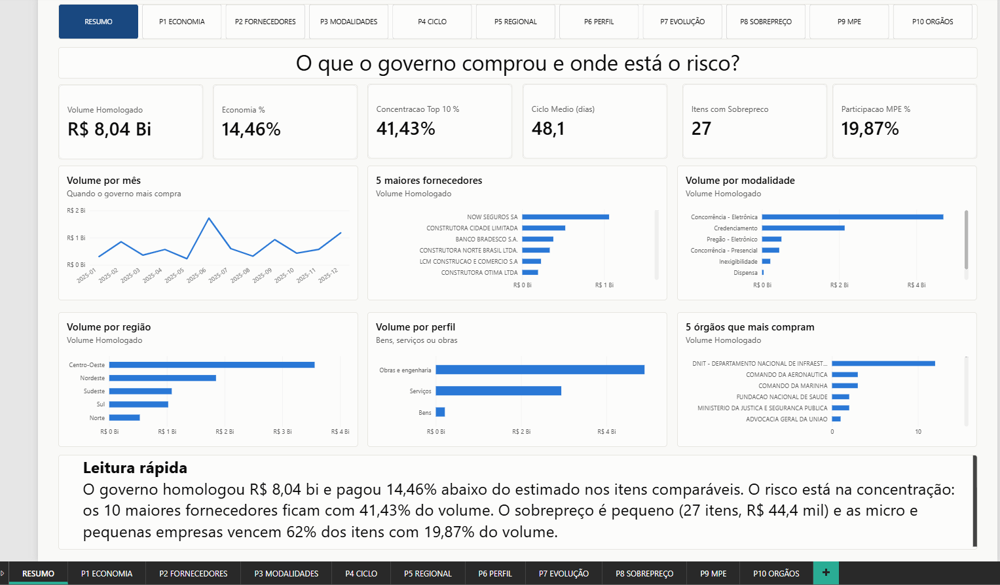

### P1. Quanto o governo economizou?
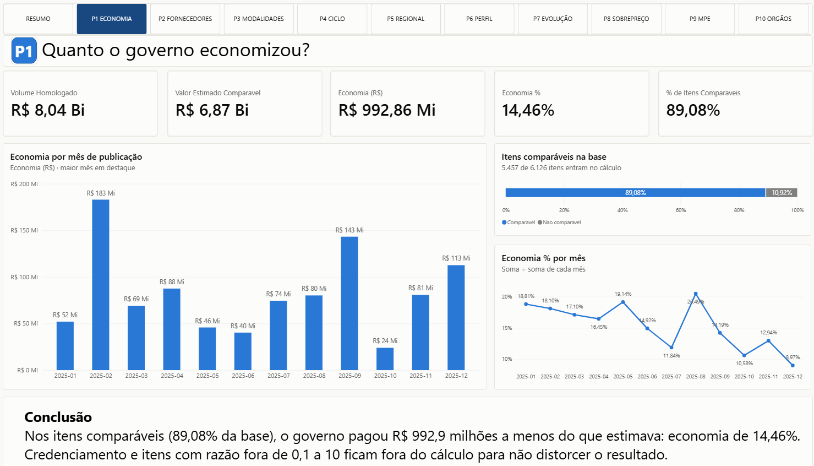

Nos itens comparáveis (89,08% da base), o governo pagou R$ 992,9 milhões a menos do que estimava, uma economia de 14,46%. Credenciamento e itens com razão fora de 0,1 a 10 ficam fora do cálculo para não distorcer o resultado.

**Consulta:** P1 em `sql/02_perguntas.sql`.

### P2. Quem concentra o orçamento? É um risco?
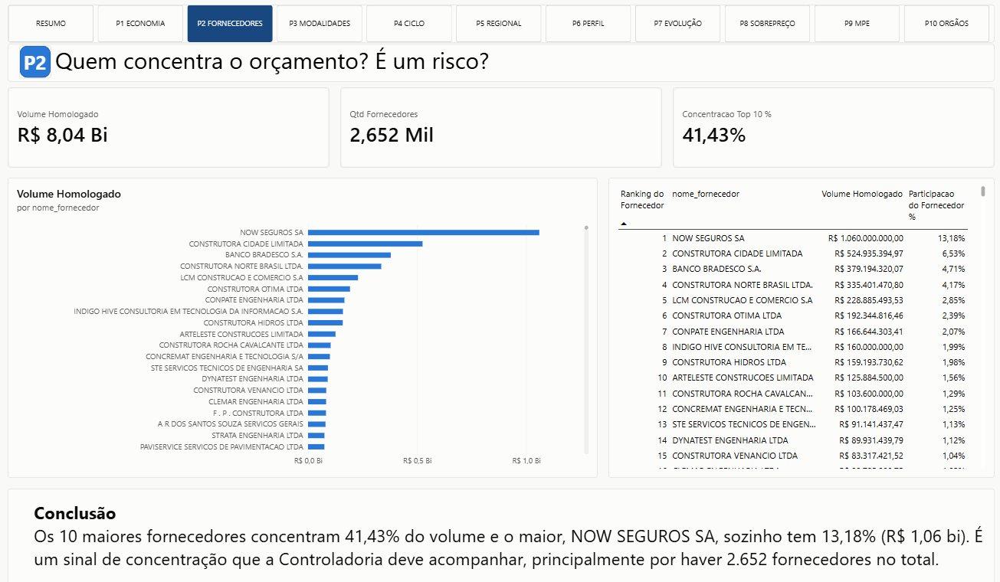

Os 10 maiores fornecedores concentram 41,43% do volume. O maior, NOW SEGUROS SA, sozinho tem 13,18% (R$ 1,06 bi). É um sinal de concentração que a Controladoria deve acompanhar, ainda mais com 2.652 fornecedores no total.

### P3. Qual modalidade economiza mais e qual movimenta mais dinheiro?
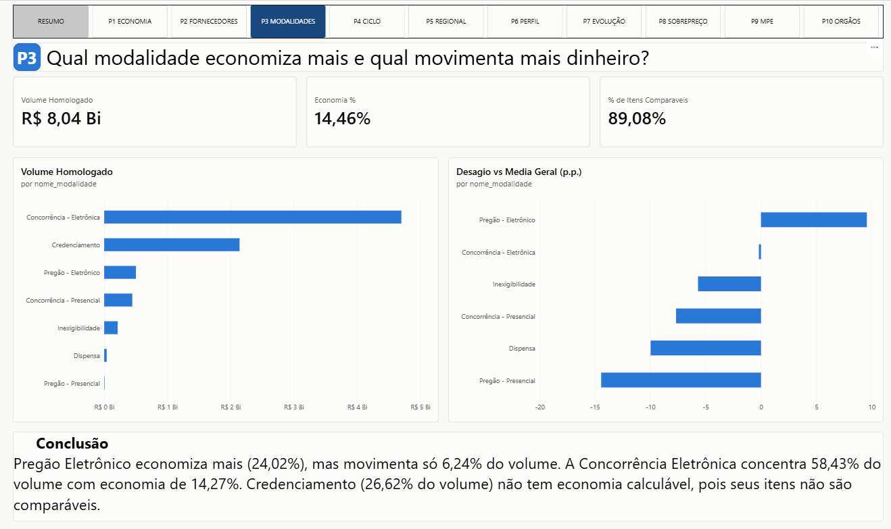

O Pregão Eletrônico economiza mais (24,02%), mas movimenta só 6,24% do volume. A Concorrência Eletrônica concentra 58,43% do volume com economia de 14,27%. Credenciamento (26,62% do volume) não tem economia calculável, porque seus itens não são comparáveis.

### P4. Onde as compras demoram mais?
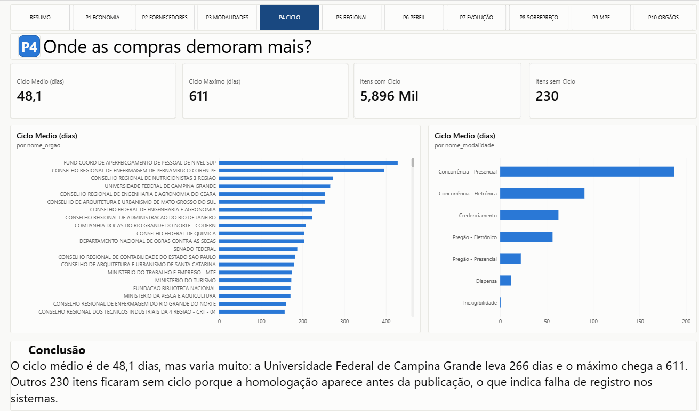

O ciclo médio é de 48,1 dias, mas varia muito e o máximo chega a 611. Por modalidade, a Concorrência Presencial é a mais lenta (cerca de 187 dias) e Inexigibilidade e Dispensa são as mais rápidas.

O gráfico por órgão do painel mostra todos os órgãos, e os maiores ciclos (428 e 395 dias) são de órgãos com um único item, o que diz pouco sobre o órgão. A consulta P4 do SQL só considera órgãos com 5 ou mais itens com ciclo. Nesse recorte, a Universidade Federal de Campina Grande leva 266 dias, seguida do Conselho Federal de Engenharia e Agronomia (223) e do DNIT (156).

Outros 230 itens ficaram sem ciclo porque a homologação aparece antes da publicação, o que indica falha de registro nos sistemas.

### P5. Onde se gasta mais e onde se consegue mais desconto?
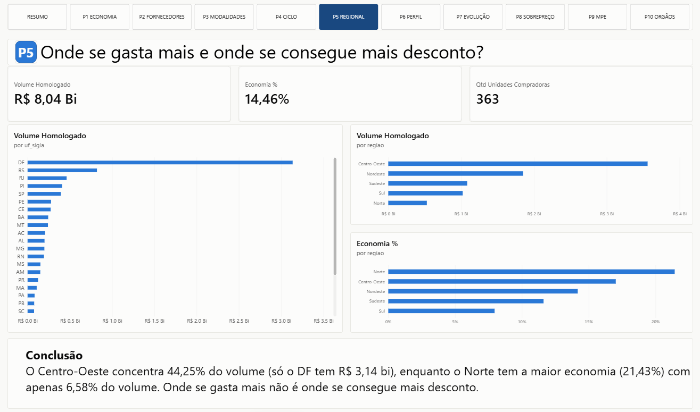

O Centro-Oeste concentra 44,25% do volume (só o DF tem R$ 3,14 bi), enquanto o Norte tem a maior economia (21,43%) com apenas 6,58% do volume. Onde se gasta mais não é onde se consegue mais desconto.

### P6. Em que o dinheiro público é gasto: bens, serviços ou obras?
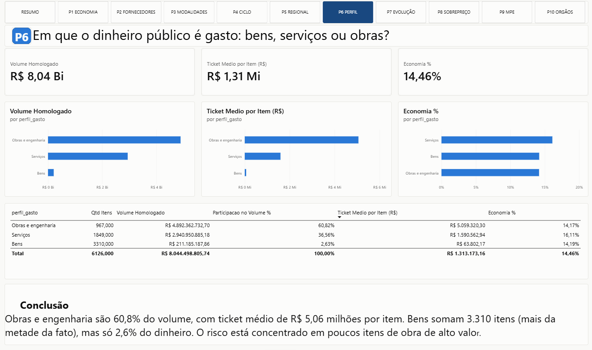

Obras e engenharia são 60,8% do volume, com ticket médio de R$ 5,06 milhões por item. Bens somam 3.310 itens (mais da metade da fato), mas só 2,6% do dinheiro. O risco está concentrado em poucos itens de obra de alto valor.

### P7. Quando o governo mais compra? A economia acompanha o volume?
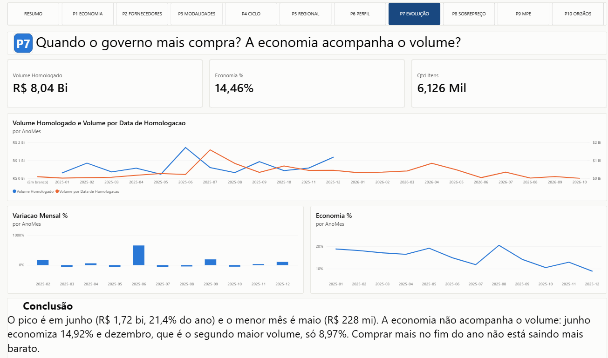

O pico é em junho (R$ 1,72 bi, 21,4% do ano) e o menor mês é maio (R$ 228 mi). A economia não acompanha o volume: junho economiza 14,92% e dezembro, o segundo maior volume, só 8,97%. Comprar mais no fim do ano não está saindo mais barato.

### P8. Onde o governo pagou acima do estimado e quanto isso custou?
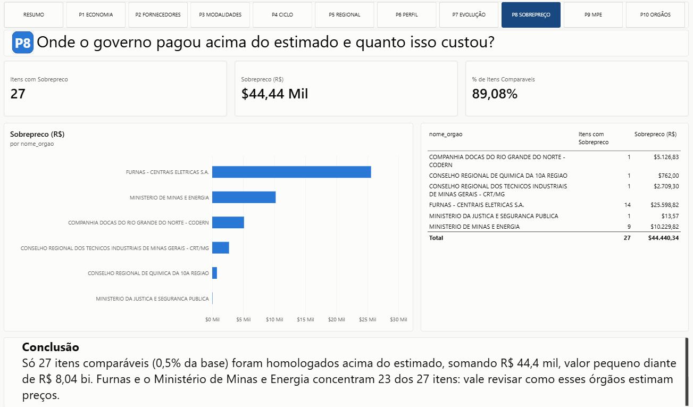

Só 27 itens comparáveis (0,5% da base) foram homologados acima do estimado, somando R$ 44,4 mil, um valor pequeno diante de R$ 8,04 bi. Furnas e o Ministério de Minas e Energia concentram 23 dos 27 itens: vale revisar como esses órgãos estimam preços.

### P9. As micro e pequenas empresas participam? Com que deságio?
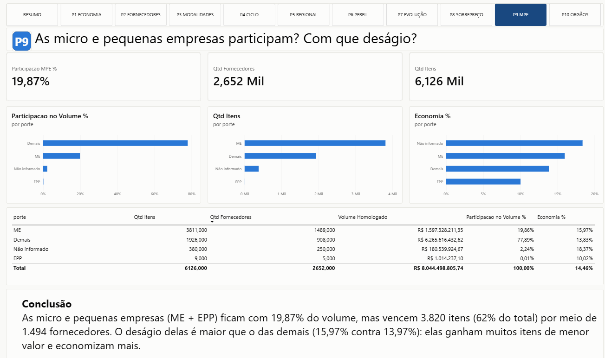

As micro e pequenas empresas (ME + EPP) ficam com 19,87% do volume, mas vencem 3.820 itens (62% do total) por meio de 1.494 fornecedores.

No painel o porte aparece separado: as ME têm 3.811 itens, 19,86% do volume e deságio de 15,97%; as EPP têm só 9 itens e 0,01% do volume. Entre os demais, o porte "Demais" economiza 13,83% e o "Não informado" 18,37% (380 itens, só 2,24% do volume). No SQL (P9) o grupo MPE aparece contra todo o resto junto (inclusive o "Não informado"), com 15,97% contra 13,97%.

Nas duas leituras as micro e pequenas empresas economizam mais que os fornecedores de porte "Demais": elas ganham muitos itens de menor valor e economizam mais.

### P10. Quem compra mais e quanto cada Poder economiza?
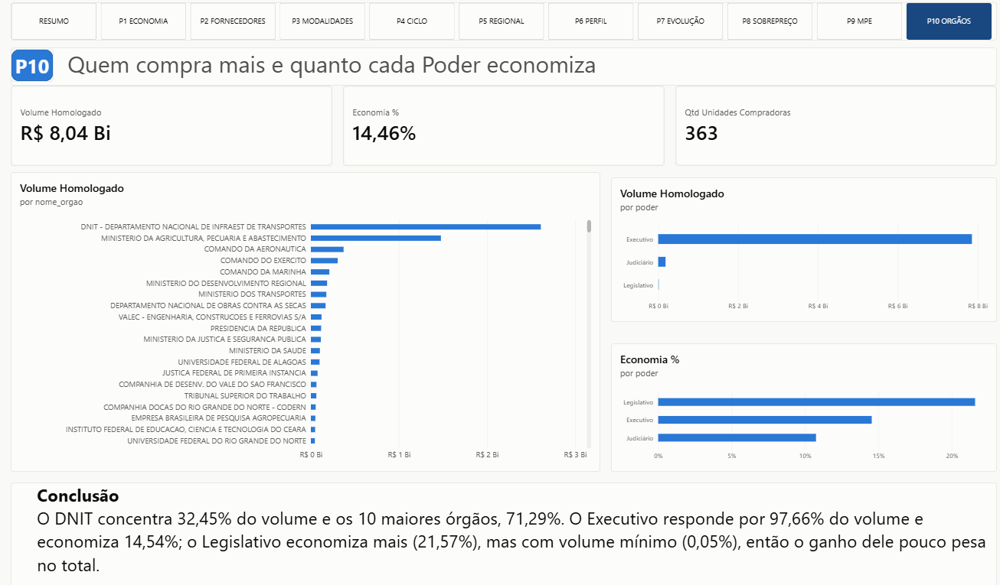

O DNIT concentra 32,45% do volume e os 10 maiores órgãos, 71,29%. O Executivo responde por 97,66% do volume e economiza 14,54%. O Legislativo economiza mais (21,57%), mas com volume mínimo (0,05%), então o ganho dele pouco pesa no total.

## 11. Três medidas DAX explicadas

### 11.1 Variação Mensal % (inteligência temporal)

```DAX
Variacao Mensal % =
VAR VolumeAtual = [Volume Homologado]
VAR VolumeAnterior =
    CALCULATE ( [Volume Homologado], DATEADD ( Calendario[Data], -1, MONTH ) )
RETURN
    DIVIDE ( VolumeAtual - VolumeAnterior, VolumeAnterior )
```

- `VAR VolumeAtual`: guarda o volume do mês que está no contexto do visual.
- `VAR VolumeAnterior`: o `CALCULATE` recalcula o mesmo volume, mas o `DATEADD(..., -1, MONTH)` empurra o calendário um mês para trás. O resultado é o volume do mês anterior.
- `DIVIDE ( atual - anterior, anterior )`: a variação em relação ao mês anterior. O `DIVIDE` devolve vazio quando o anterior é zero ou vazio, sem dar erro.
- Em janeiro não existe mês anterior, então o resultado fica em branco. É esperado.
- Funciona só com `Calendario[AnoMes]` no eixo. Com o nome do mês sozinho (`Mes`), janeiro de anos diferentes se misturaria.
- Formato: porcentagem.

### 11.2 Sobrepreço (R$) (iteradora)

```DAX
Sobrepreco (R$) =
SUMX (
    FILTER (
        fato_item_contratado,
        fato_item_contratado[comparavel] = 1
            && fato_item_contratado[valor_total_homologado] > fato_item_contratado[valor_total_estimado]
    ),
    fato_item_contratado[valor_total_homologado] - fato_item_contratado[valor_total_estimado]
)
```

- `FILTER` olha a fato linha a linha e deixa passar só os itens comparáveis com homologado maior que o estimado. A condição `comparavel = 1` é importante: sem ela, o número passa de 27 para 60 itens.
- `SUMX` percorre essas linhas e, em cada uma, calcula homologado menos estimado. Depois soma tudo.
- Precisa de iteradora porque a conta (uma subtração) é feita por linha, antes de somar. Um `SUM` simples somaria uma coluna só.
- Resultado: R$ 44.440,34, igual ao do SQL (P8).
- Formato: moeda R$.

### 11.3 Concentração Top 10 % (TOPN e KEEPFILTERS)

```DAX
Concentracao Top 10 % =
VAR Top10 =
    TOPN ( 10, ALL ( dim_fornecedor ), [Volume Homologado] )
VAR VolumeTop10 =
    CALCULATE ( [Volume Homologado], KEEPFILTERS ( Top10 ) )
VAR VolumeTotal =
    CALCULATE ( [Volume Homologado], ALL ( dim_fornecedor ) )
RETURN
    DIVIDE ( VolumeTop10, VolumeTotal )
```

- `Top10`: o `TOPN` pega os 10 fornecedores de maior volume. O `ALL(dim_fornecedor)` garante que o ranking ignora qualquer filtro de fornecedor que esteja no visual.
- `VolumeTop10`: soma o volume só desses 10. O `KEEPFILTERS` mantém os outros filtros da página (como o filtro de data) em vez de apagá-los.
- `VolumeTotal`: volume de todos os fornecedores. O `ALL` tira o filtro de fornecedor para o total ser sempre o geral.
- `DIVIDE`: percentual como soma ÷ soma. Resultado: 41,43%, igual à segunda consulta da P2 no SQL.
- Formato: porcentagem.

## 12. Planejamento em Sprints

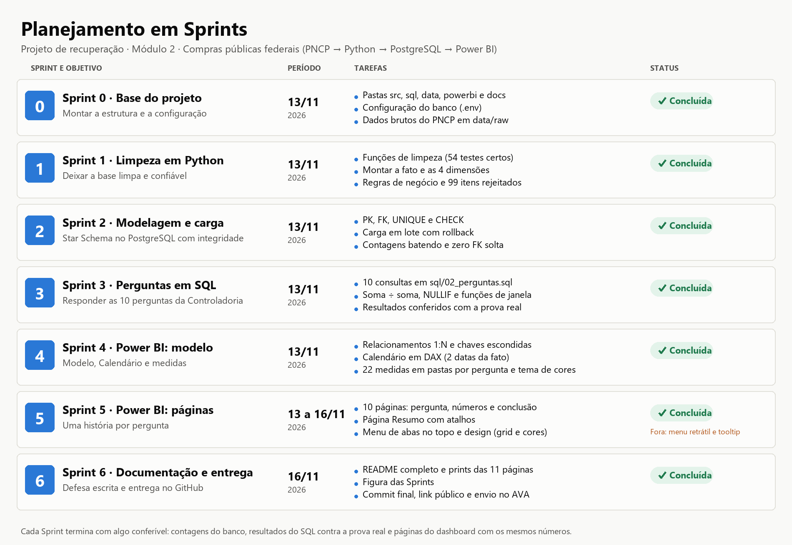

| Sprint | Objetivo | Período | Status |
|---|---|---|---|
| 0 | Montar a base: estrutura de pastas, configuração do banco, dados brutos | 13/11/2026 | Concluída |
| 1 | Limpeza em Python e montagem da fato e das dimensões | 13/11/2026 | Concluída |
| 2 | Modelagem no PostgreSQL e carga em lote, com conferência | 13/11/2026 | Concluída |
| 3 | As 10 perguntas em SQL (`sql/02_perguntas.sql`) | 13/11/2026 | Concluída |
| 4 | Power BI: modelo, Calendário e as 22 medidas | 13/11/2026 | Concluída |
| 5 | Power BI: 10 páginas, página Resumo, menu de abas e design (menu retrátil e tooltip ficaram de fora) | 13 a 16/11/2026 | Concluída |
| 6 | README, prints e figura das Sprints | 16/11/2026 | Concluída |

**O que mudou no caminho:** a ideia era deixar o design para o fim, e foi o que fiz. No meio do trabalho acrescentei uma página Resumo, com as principais análises e atalhos para cada página, para quem quer só uma visão rápida.

## 13. O que mudou em relação à primeira entrega

Nada, porque não houve primeira entrega. Esta é a minha primeira entrega do projeto. Por isso o histórico de commits começa do zero e mostra todas as etapas.

## 14. Melhorias futuras

- Tratar nomes parecidos de fornecedores com o mesmo CNPJ raiz (filiais), para ver o grupo econômico e não só o CNPJ.
- Procurar sinais de risco além da concentração, como itens homologados com valor muito acima da mediana de itens parecidos.
- Separar serviços continuados de eventuais no perfil do gasto.
- Trocar os CSVs por uma leitura direta da API do PNCP, com carga incremental.
- Automatizar o pipeline (agendar o `montar_tabelas` e o `carregar`) e criar testes para a montagem das tabelas, além dos testes de limpeza.
- Incluir mais meses para comparar o mesmo período entre anos.
- Trocar o menu de abas por um menu retrátil com botão e bookmarks, para liberar espaço na página.
- Criar uma página de tooltip para os gráficos de modalidade, mostrando volume, participação, economia, deságio e ciclo ao passar o mouse.
